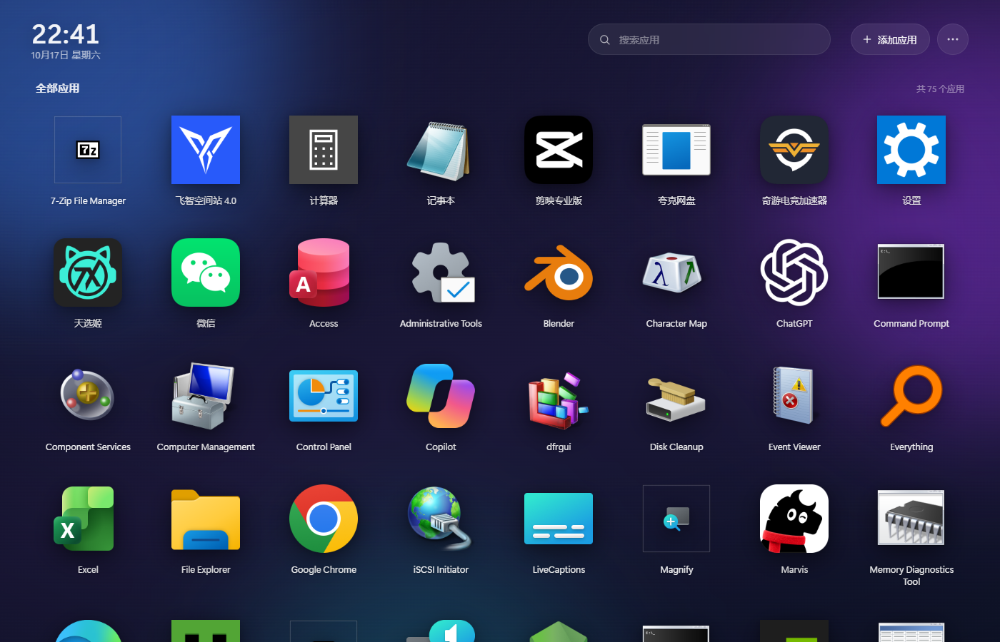

# 应用集合 · AppHub

把 Windows 上的应用集中到一个像手机桌面一样的窗口里：点图标打开、拖拽归类、隐藏、换图标、调大小。



## 功能

- 自动扫描开始菜单、桌面和 Windows 应用（Store / UWP）
- 提取原版透明图标，支持 64–128px 图标大小滑杆
- 拖到另一个图标中间 → 合成文件夹并命名；拖到两侧 → 调整顺序；拖到文件夹图标上 → 归类
- 拖动到列表边缘自动滚动
- 右键隐藏 / 恢复、添加应用、更换图标（选图片，或直接把图片拖到图标上）
- 4 套壁纸、搜索、按名称排序、状态本地保存
- 默认最大化启动，F11 切换全屏；默认开机自启动，可在菜单里关闭
- 独立窗口版 `AppHub.exe`（WebView2），同时保留浏览器启动方式

## 直接使用

1. 双击 `AppHub.exe`（Windows 10/11；需要 Node.js 和 Microsoft Edge WebView2 运行时，后者系统通常已自带）。
2. 第一次启动会自动扫描应用，几秒后出现桌面。
3. 想放到桌面：右上角「…」→「创建桌面快捷方式」。

备用启动：`启动应用集合.vbs`（Edge 应用窗口），需要安装 Node.js。

## 从源码构建

环境：Windows 10/11、Node.js、.NET Framework 4.x（系统自带）、Microsoft Edge WebView2 Runtime。

```powershell
powershell -ExecutionPolicy Bypass -File desktop\build.ps1
```

生成的 `AppHub.exe` 和 WebView2 DLL 会放到项目根目录。

开发模式（浏览器窗口）：

```powershell
node server\server.js --open
```

## 目录结构

```
AppHub/
├─ AppHub.exe                 独立窗口版
├─ 启动应用集合.vbs            浏览器版启动器
├─ assets/                    应用图标
├─ desktop/
│  ├─ AppHub.cs               WebView2 窗口宿主源码
│  ├─ build.ps1               编译脚本
│  └─ lib/                    WebView2 SDK
└─ server/
   ├─ server.js               本地服务（扫描/启动/状态）
   ├─ ps/                     PowerShell 扫描与图标提取
   └─ web/                    界面（HTML/CSS/JS）
```

## 数据与隐私

分类、排序、隐藏和自定义图标都保存在本机 `data/` 目录，不会上传。`.gitignore` 已排除该目录，提交到 GitHub 时不会带上个人应用列表和图标缓存。

## License

MIT
